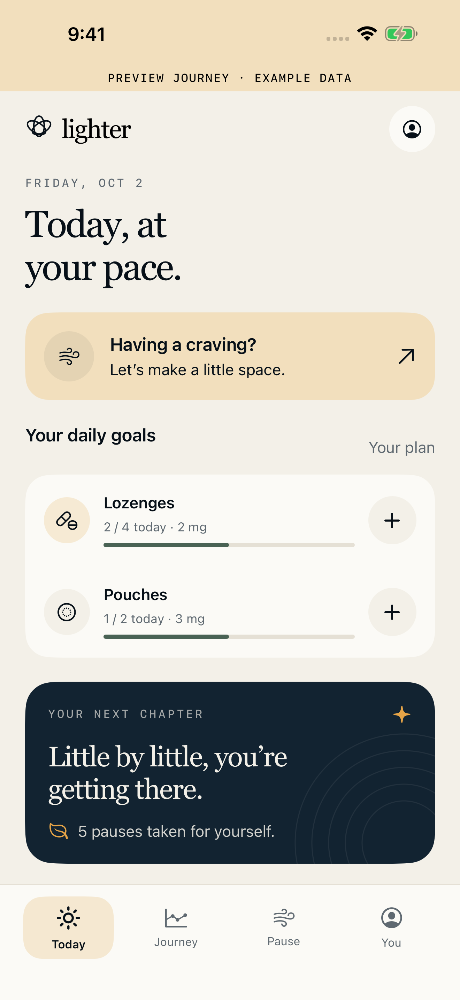
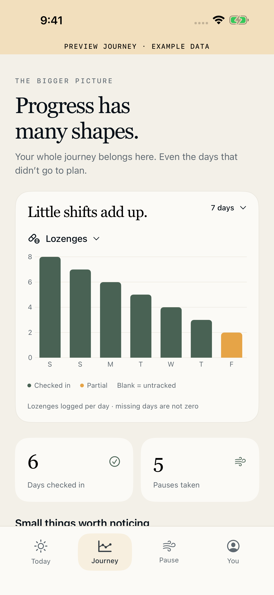
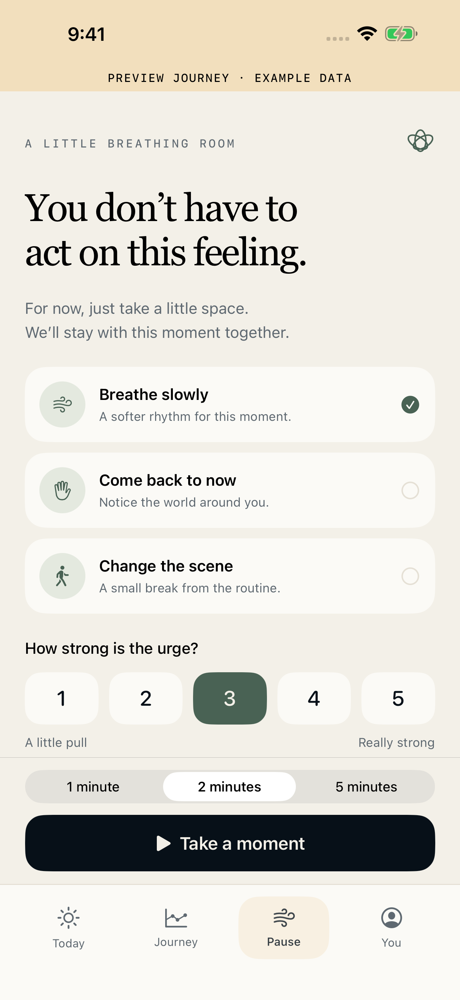
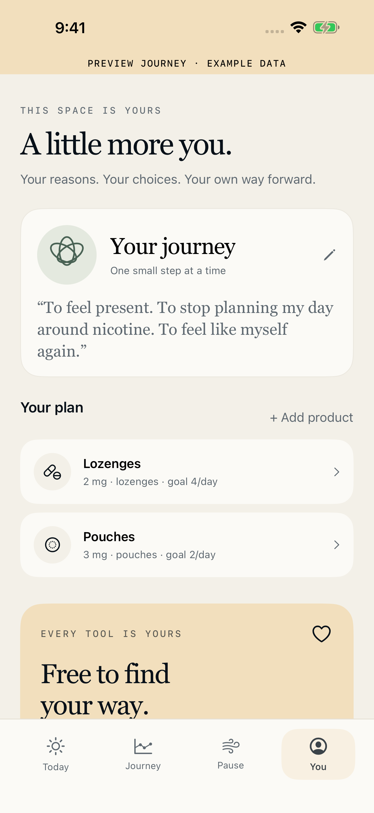
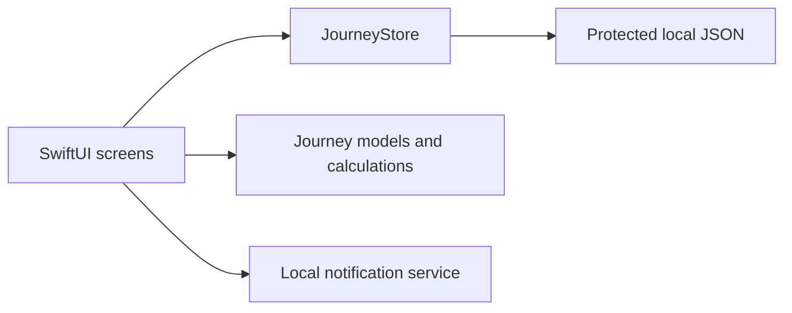

# Lighter · Quit Nicotine

A calm, private iPhone and iPad app for adults who want to quit nicotine or understand their use while cutting down. Built by **Yahya Haider** with SwiftUI.

**Portfolio case study · Product design and native iOS engineering**

Every quitting tool is free. The first release has no subscriptions, purchases, advertising, or analytics SDKs.

  
  
  
  

Screenshots use synthetic example data, clearly identified by the preview banner. Real journeys start with onboarding.

## What it does

- Tracks pouches, lozenges, gum, vaping, cigarettes, patches, snus/dip, and custom products. Different products and strengths stay separate.
- Supports a user-chosen quit date or daily reduction goals.
- Logs use, past entries, cravings, triggers, and daily reflections. Entries can be edited or undone.
- Shows per-product history and spending estimates based on user-entered prices and logs. Missing days remain unconfirmed.
- Offers short breathing, grounding, and routine-change pauses with before/after reflection.
- Provides optional local reminders, journey export, and deletion.

Lighter is a self-tracking and reflection tool. It does not diagnose dependence, prescribe medication doses or tapers, or promise clinical outcomes.

## Design and engineering decisions

| Challenge                                            | Implementation                                                                                |
| ---------------------------------------------------- | --------------------------------------------------------------------------------------------- |
| People use different nicotine products and strengths | Separate product settings, goals, and histories; no assumed dose equivalence                  |
| Tracking needs to remain trustworthy after edits     | Historical product/price snapshots and unconfirmed missing days                               |
| Private reflections need reliable storage            | Protected on-device files, atomic writes, corrupted-file recovery, and user-controlled export |
| The app needs to work across users and devices       | Dynamic Type, VoiceOver labels, reduced motion, and iPhone/iPad layouts                       |

The visual system uses warm paper tones, restrained amber and sage accents, serif headings, and clear native controls. Four focused tabs separate daily actions, history, craving pauses, and personal settings.

## Engineering

**Swift 6 · SwiftUI · iOS 17+ · iPhone and iPad · XcodeGen**

The app has no custom backend, account system, cloud sync, or third-party runtime dependencies. Journey data is stored on the device in a protected JSON file; system backups may include it. Export is initiated by the user through Apple's share sheet.

Implementation details include validation before mutation, atomic writes, corrupted-file recovery, calendar-aware calculations, and snapshots that preserve historical product names and prices. The interface supports Dynamic Type, VoiceOver labels, reduced motion, and iPad layouts.

## Validation

As of **October 2, 2026**, 20 journey tests and 10 iPhone UI tests passed. iPad portrait/landscape checks passed on installed iOS 26.1 and 26.4 simulators. Swift formatting, an unsigned Release build, and signed App Store archive/export checks passed.

The tests exercise calculation boundaries, data validation, persistence and recovery, onboarding, editing, privacy/export, and free access. Physical-device checks remain separate from simulator validation.

## Release and support

The public App Store link will be added after launch is verified.

- [Privacy policy](https://launchwebflow.com/lighter/privacy)
- [Support](https://launchwebflow.com/lighter/support)
- Developer contact: **yahyahaider@launchwebflow.com**

## About this repository

A portfolio case study for Lighter’s product, interface, and native implementation.

[More work by LaunchWebflow](https://launchwebflow.com)
